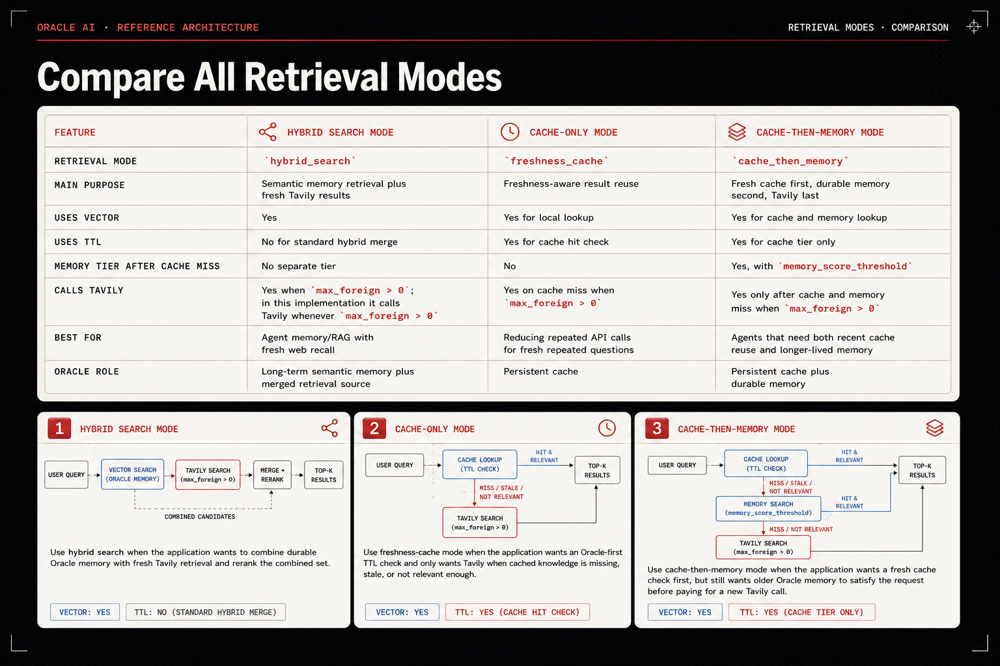

# Oracle Database Hybrid RAG

Use Tavily Search with Oracle to retrieve local vectors, reuse fresh cache
rows, and retain durable memory. This guide targets this fork's
`upstream-port` implementation and its configured `OracleDB` adapter.

The [backend contract](../../tavily/databases/architecture.md) explains the
shared client. The [Oracle provider guide](../../tavily/databases/oracledb/README.md)
and [architecture](../../tavily/databases/oracledb/architecture.md) cover
schema-dependent behavior and the write/cleanup rules.

## 1. Install from this fork

From the repository root:

```bash
python -m venv .venv
source .venv/bin/activate
python -m pip install -e .
python -m pip install oracledb cohere
```

The current `setup.py` has no `oracle`, `mongodb`, or `hybrid`
extras. Installing the published upstream package alone does not select this
fork's Oracle implementation.

The default helpers use Cohere for embeddings and reranking. You can instead
pass your own `embedding_function(texts, input_type)` and
`ranking_function(query, documents, top_n)` callables to
`TavilyHybridClient`. Query and persisted-document embeddings must use a
compatible model and vector dimension.

## 2. Configure the environment

Set these variables before importing the SDK in Python:

```bash
export TAVILY_API_KEY='your-tavily-key'
export CO_API_KEY='your-cohere-key'
export ORACLE_USER='your-database-user'
export ORACLE_PASSWORD='your-database-password'
export ORACLE_DSN='dbhost:1521/service_name'
```

Use a database supporting `VECTOR` and `VECTOR_DISTANCE`. Oracle Text
is needed only for optional native hybrid retrieval. The table and optional
index helpers also require the corresponding database privileges.

## 3. Create the table

The example uses 1024-dimensional vectors; adjust the dimension to match your
embedding function. Ordinary vector retrieval needs content and embeddings.
The timestamp supports the cache examples.

```sql
CREATE TABLE tavily_documents (
    id NUMBER GENERATED ALWAYS AS IDENTITY PRIMARY KEY,
    content CLOB,
    embeddings VECTOR(1024, FLOAT32),
    added_at TIMESTAMP DEFAULT SYSTIMESTAMP
);
```

For the provenance and cache/memory examples, add:

```sql
ALTER TABLE tavily_documents ADD (
    raw_payload JSON,
    source_url VARCHAR2(1000),
    source_title VARCHAR2(500),
    retrieval_query VARCHAR2(1000),
    retrieval_timestamp TIMESTAMP WITH TIME ZONE,
    retrieval_mode VARCHAR2(30),
    cache_hit NUMBER(1),
    inserted_from VARCHAR2(30),
    provider_name VARCHAR2(50),
    memory_scope VARCHAR2(30),
    expires_at TIMESTAMP WITH TIME ZONE,
    last_seen_at TIMESTAMP WITH TIME ZONE,
    query_count NUMBER DEFAULT 0,
    content_hash VARCHAR2(64)
);
```

The adapter does not create or upgrade tables automatically. Constructor
validation does not fully preflight the schema; missing/incompatible columns
can be reported when a query or insert first needs them.

## 4. Connect and configure clients

This guide shares one caller-owned connection. The small factory below keeps
the example configurations readable; it is ordinary application code.

```python
import os

import oracledb
from tavily import TavilyHybridClient
from tavily.databases.oracledb import OracleDB

connection = oracledb.connect(
    user=os.environ["ORACLE_USER"],
    password=os.environ["ORACLE_PASSWORD"],
    dsn=os.environ["ORACLE_DSN"],
)

def make_client(**oracle_options):
    return TavilyHybridClient(
        api_key=os.environ["TAVILY_API_KEY"],
        database=OracleDB(
            connection=connection,
            table_name="TAVILY_DOCUMENTS",
            **oracle_options,
        ),
    )
```

All Oracle settings belong on `OracleDB`. Legacy provider-string Oracle
construction is unsupported. Historical MongoDB calls remain compatible
through `legacy_handling.py`.

## 5. Choose a retrieval mode



These are independent usage recipes over the same table shape. Existing
rows and configured thresholds determine whether a cache lookup hits; a first
call is not guaranteed to miss.

### Hybrid search

`hybrid_search` retrieves Oracle candidates and calls Tavily whenever
`max_foreign > 0`, then reranks the combined results.

```python
client = make_client(
    retrieval_mode="hybrid_search",
    persistence_depth="cache_plus_memory",
    enable_memory_metadata=True,
    enable_json_payload=True,
    enable_provenance_metadata=True,
)

try:
    results = client.search(
        "Oracle Database vector search features",
        max_results=5,
        max_local=5,
        max_foreign=5,
        save_foreign=True,
        search_depth="basic",
        max_age_hours=24,
    )
    for result in results:
        print(result["origin"], result["score"], result["content"][:120])
finally:
    client.close()
```

The result shape is `content`, `score`, and `origin`. `origin`
is `"local"` for Oracle rows and `"foreign"` for projected Tavily rows.
The projection does not return the original URL/title or persisted metadata.

Set `max_foreign=0` for local-only search with reranking. Set
`max_local=0` for Oracle's foreign fallback route, which skips local
result lookup and reranking. Query embedding and enabled automatic cleanup
can still run.

Additional search keywords such as `max_age_hours`,
`include_domains_mode`, `fetch_timeout`, and `cache_fallback` are
forwarded to Tavily when it is called. They do not configure Oracle cache
freshness or filter a local cache hit.

### Freshness cache

`freshness_cache` returns fresh Oracle rows meeting the score threshold,
and calls Tavily only on a miss.

```python
cache_client = make_client(
    retrieval_mode="freshness_cache",
    cache_ttl_seconds=3600,
    cache_score_threshold=0.70,
    persistence_depth="cache_only",
    enable_memory_metadata=True,
    enable_json_payload=True,
    enable_provenance_metadata=True,
)

try:
    first = cache_client.search(
        "Oracle Database vector search features",
        max_results=3,
        max_local=5,
        max_foreign=3,
        save_foreign=True,
    )
    second = cache_client.search(
        "Oracle Database vector search features",
        max_results=3,
        max_local=5,
        max_foreign=3,
        save_foreign=True,
    )
    print([row["origin"] for row in first])
    print([row["origin"] for row in second])
finally:
    cache_client.close()
```

If the first call misses, it can write Tavily results. A later call returns
local results when those rows are fresh and similar enough. With
`max_foreign=0`, a cache miss returns `[]`.

Freshness uses `EXPIRES_AT` when populated, with the configured cache
timestamp as the fallback for null expiry. Without an expiry column it uses
the timestamp and `cache_ttl_seconds`.

### Cache then memory

`cache_then_memory` checks fresh cache first, durable memory second, and
Tavily last.

```python
memory_client = make_client(
    retrieval_mode="cache_then_memory",
    cache_ttl_seconds=3600,
    cache_score_threshold=0.70,
    memory_score_threshold=0.65,
    persistence_depth="cache_plus_memory",
    enable_json_payload=True,
    enable_provenance_metadata=True,
)

try:
    results = memory_client.search(
        "How can Oracle VECTOR support agent search memory?",
        max_results=5,
        max_local=5,
        max_foreign=5,
        save_foreign=True,
    )
finally:
    memory_client.close()
```

This mode enables lifecycle metadata internally. Both cache and memory use
`max_local`; there is no `memory_max_results` argument.
`cache_plus_memory` rows remain eligible for the memory tier after cache
expiry. Their retention is also the default persistence depth for this mode.

Local hits do not increment `QUERY_COUNT`, refresh `LAST_SEEN_AT`,
or extend expiry. Those metadata fields are maintained on writes/upserts.

## 6. Bound writes to an ownership scope

For a shared table, add your ownership column:

```sql
ALTER TABLE tavily_documents ADD tenant_id VARCHAR2(64);
```

Then configure a fixed scope:

```python
scoped_client = make_client(
    metadata_filters={"TENANT_ID": "tenant-a"},
    upsert_key="source_url",
    enable_provenance_metadata=True,
)

try:
    scoped_client.search(
        "Oracle vector search",
        max_local=5,
        max_foreign=3,
        save_foreign=True,
    )
finally:
    scoped_client.close()
```

The scalar tenant value is filled into automatically built documents.
Conflicting values are rejected. Retrieval and cleanup use the configured
scope, and upserts match both source URL and exact ownership values rather
than overwriting another owner's row.

A list/tuple/set filter permits multiple values for reads but requires each
write document to provide an explicit, non-null permitted value. Use a custom
`save_foreign` transform when that selection belongs to application logic.
A custom transform receives the original Tavily result plus `embeddings`;
it must build all required storage metadata itself.

## 7. Control persistence and duplicates

`oracle_persist_score_threshold` filters Tavily results before persistence;
`oracle_max_persisted_foreign` then caps the remaining results in their
existing order. These options do not remove search-response candidates.

For semantic suppression without a keyed upsert:

```python
dedup_client = make_client(
    dedup_similarity_threshold=0.95,
    enable_provenance_metadata=False,
    oracle_max_persisted_foreign=3,
    oracle_persist_score_threshold=0.5,
)

try:
    dedup_client.search(
        "Oracle vector search",
        max_local=5,
        max_foreign=5,
        save_foreign=True,
    )
finally:
    dedup_client.close()
```

Deduplication compares cosine vector similarity with eligible stored rows and
documents retained earlier in the same batch, matching exact ownership values.
It excludes expired cache-only references when lifecycle columns are available.

Detailed provenance need not be enabled: automatic documents populate whichever
of `PROVIDER_NAME` and `INSERTED_FROM` exist. When present, those columns
must each be `"tavily"` on a reference row. Custom documents must provide
their own markers. Existing unmarked rows are not backfilled.

Choose `upsert_key="source_url"` or `"content_hash"` when repeated keyed
results should update a scoped row. A candidate with a nonempty configured
key bypasses semantic suppression to preserve that update. Large semantic
deduplication batches can incur pairwise Oracle reads; the check is not a
concurrent-writer uniqueness constraint.

## 8. Inspect stored provenance

With JSON and detailed provenance enabled:

```sql
SELECT source_title,
       source_url,
       retrieval_query,
       retrieval_mode,
       inserted_from,
       provider_name
FROM tavily_documents
ORDER BY retrieval_timestamp DESC
FETCH FIRST 10 ROWS ONLY;
```

The JSON envelope contains `result` and `provenance` objects:

```sql
SELECT JSON_VALUE(raw_payload, '$.provenance.retrieval_query') AS query_text,
       JSON_VALUE(raw_payload, '$.provenance.provider_name') AS provider
FROM tavily_documents
WHERE raw_payload IS NOT NULL;
```

`CACHE_HIT` on the automatic write path is currently zero: local hits
short circuit before persistence.

## 9. Optional indexes and native hybrid search

```python
database = OracleDB(
    connection=connection,
    table_name="TAVILY_DOCUMENTS",
    vector_index_name="TAVILY_DOCS_VEC_IDX",
    vector_index_type="HNSW",
    vector_index_distance="COSINE",
    text_index_name="TAVILY_DOCS_TEXT_IDX",
    enable_native_hybrid_search=True,
)

print("Created vector index:", database.ensure_vector_index())
print("Created text index:", database.ensure_text_index())

native_client = TavilyHybridClient(
    api_key=os.environ["TAVILY_API_KEY"],
    database=database,
)
try:
    results = native_client.search("Oracle vector search", max_results=5)
finally:
    native_client.close()
```

The helpers return `True` after creation or `False` when the selected
index name already exists. They check name existence, not whether an existing
index has the right definition.

Native hybrid is disabled by default. When enabled, it adds vector similarity
and scaled Oracle Text score for each candidate row. Cache/memory thresholds
then compare that combined returned score; semantic deduplication remains a
cosine vector comparison. Recognized Oracle Text query errors trigger a
vector-only retry. Other database errors propagate.

Cache/memory modes and semantic deduplication require
`vector_index_distance="COSINE"`. Ordinary vector-only hybrid retrieval
can use the other metrics supported by the adapter.

## 10. Cleanup and connection lifecycle

```python
cleanup_database = OracleDB(
    connection=connection,
    table_name="TAVILY_DOCUMENTS",
    metadata_filters={"TENANT_ID": "tenant-a"},
)
deleted = cleanup_database.cleanup_cache()
print("Deleted expired scoped cache rows:", deleted)
```

Cleanup preserves durable `cache_plus_memory` rows and applies the
configured ownership filters to every deletion branch. Explicit
`cache_only` lifecycle rows can be removed when expired. Legacy rows
without lifecycle scope require cache-mode provenance and any available
Tavily origin markers. Schemas with insufficient evidence are preserved.

Cleanup can use `MEMORY_SCOPE` and `EXPIRES_AT` without `ADDED_AT`.
Automatic cache writes still require the configured cache timestamp column.
See the [full rules](../../tavily/databases/oracledb/architecture.md#cleanup-rules)
for partial schemas.

`auto_cleanup_cache=True` runs cleanup before retrieval, rate-limited by
`cache_cleanup_interval_seconds`. Persistence, cleanup, and index helpers
commit on the supplied connection, so keep unrelated pending transactions
separate.

Close the shared connection after finishing these recipes:

```python
connection.close()
```

An injected connection stays open when a hybrid client closes. For adapter
ownership instead, configure `OracleDB(user=..., password=..., dsn=...)`
and let `client.close()` close the managed connection. Callable-validation
or later client-initialization failures also close an accepted managed backend.

## Troubleshooting

| Symptom | Check |
| --- | --- |
| An installation extra has no effect | Install this fork with `pip install -e .` and explicit `oracledb`/`cohere` dependencies. |
| Missing table/column or incompatible insert type | Create the schema needed by the enabled options; use a new adapter after changing its cached table schema. |
| Vector dimension mismatch | Match stored vectors, query embeddings, and the table's `VECTOR` dimension. |
| Cache always misses | Check expiry/timestamps, TTL, thresholds, filters, and embedding compatibility. |
| Durable memory misses | Check `MEMORY_SCOPE='cache_plus_memory'`, ownership filters, `memory_score_threshold`, and `max_local`. |
| An allowed-owner write is rejected | List filters require an explicit permitted owner; scalar filters can fill missing values. |
| Semantic duplicates remain | Check origin markers, exact scope, lifecycle eligibility, threshold, and whether candidates have keyed-upsert bypass. |
| Default embedding/ranking fails | Install Cohere and set its key before import, or pass custom callables. |
