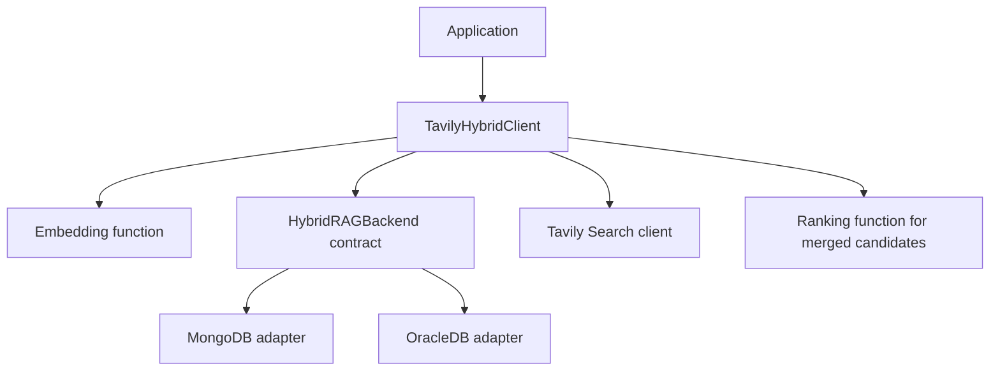

# Hybrid RAG Database Adapter Architecture

This document records why this codebase changed the original Tavily Hybrid
RAG implementation, what behavior remains compatible, and where provider
behavior now belongs. It is the provider-neutral companion to
[`oracledb/architecture.md`](oracledb/architecture.md).

## Scope and baseline

The reference `hybrid_rag.py` supplied with the original `tavily-python`
implementation supported MongoDB only. Its `TavilyHybridClient` accepted a
`db_provider` string, a MongoDB collection, an Atlas Search index, and Mongo
field names. The class then did all of the following itself:

- validated the MongoDB vector index;
- ran the `$vectorSearch` aggregation;
- called Tavily Search;
- projected, merged, and reranked local and foreign candidates; and
- embedded and inserted Tavily results into the MongoDB collection.

That is a reasonable small implementation for one fixed backend. It becomes
the wrong ownership boundary once a second backend has a different connection
model, SQL dialect, persistence schema, index management, and retrieval
policy. Oracle adds cache and durable-memory routing in addition to vector
search, so extending the original class directly would have turned it into a
provider switchboard.

The goal of this change is deliberately narrow: keep the public search
orchestration and MongoDB behavior intact, while making a database provider a
configured object that owns its own database details. This is an integration
inside `tavily-python`, not a separate Oracle package or a rewrite of Tavily's
core client.

## What changed

| Concern | Original Mongo-only design | Adapter design in this codebase | Why |
| --- | --- | --- | --- |
| Client construction | `TavilyHybridClient` received `db_provider`, `collection`, `index`, and MongoDB field settings. | `TavilyHybridClient` receives one configured `database` adapter. | The shared client no longer grows one constructor argument per provider option. |
| MongoDB retrieval | MongoDB aggregation was embedded in `TavilyHybridClient.search`. | [`MongoDB`](mongodb/mongodb.py) owns Atlas index validation, vector retrieval, document mapping, and insertion. The application supplies and owns its collection. | Preserves MongoDB behavior while isolating its driver and schema assumptions. |
| Oracle retrieval | Not present. | [`OracleDB`](oracledb/oracledb.py) owns connections, Oracle SQL, vector/text index helpers, cache/memory routing, metadata, cleanup, deduplication, and upsert behavior. | Oracle capabilities do not leak into the generic search client or MongoDB. |
| Retrieval routing | The client always searched MongoDB, optionally searched Tavily, then reranked both. | A provider returns a `RetrievalDecision`: merge, return local results, or fall back to Tavily. | Supports both the original merge flow and Oracle cache/memory short-circuiting without `if provider == ...` in the client. |
| Persistence | The client built MongoDB documents from MongoDB field names and called `collection.insert_many`. | The client computes embeddings; the adapter selects candidates, maps a result into a document, and persists it. | The database owns schema-specific writes, while embedding remains shared and consistent. |
| Resource lifecycle | The original client did not own a driver-created connection. | An adapter closes only connections/clients it created itself. | Callers can continue to manage injected database handles safely. |
| Legacy configuration | Only MongoDB was understood. | [`legacy_handling.py`](legacy_handling.py) resolves historical positional and keyword MongoDB calls into a `MongoDB` adapter. | Existing MongoDB call sites can migrate incrementally; Oracle and new providers use `database=`. |

## Resulting ownership model



The shared client owns only work that is the same for every backend:

1. create the query embedding;
2. ask the adapter for its local retrieval decision;
3. call Tavily when that decision requires foreign results;
4. project Tavily results into the common result shape;
5. rerank only when local and foreign results are being merged; and
6. create document embeddings before delegating database-specific persistence.

The adapter owns work that depends on the database:

- connecting to, validating, and closing its driver objects;
- vector, text, cache, and memory queries;
- provider-specific routing policy;
- field names and persistence document shape;
- inserts, upserts, deduplication, TTL cleanup, and index helpers; and
- provider-only configuration and validation.

This separation is important: the shared client must not need to know whether
an adapter uses `$vectorSearch`, `VECTOR_DISTANCE`, pgvector, or another
backend-specific query language.

## The adapter contract

[`base.py`](base.py) defines the runtime-checkable structural
`HybridRAGBackend` protocol. `Database` is a compatibility alias for that
protocol. A configured object with the required methods can be supplied as
`database=` without inheriting from a built-in adapter. `DatabaseAdapter`
is an optional base class with no-op `validate()` and `close()` methods and
an identity `select_foreign_results_for_persistence()` implementation.

| Method | Contract | Called by |
| --- | --- | --- |
| `validate()` | Validate configuration and any cheap required database capability. Raise a useful error before client creation completes. | Client initialization |
| `retrieve(request)` | Search local storage and return a `RetrievalDecision`. | Every `search()` |
| `build_persistence_document(result, embedding, context)` | Map one Tavily result and its generated embedding to the provider's storage shape. | `save_foreign=True` |
| `select_foreign_results_for_persistence(results)` | Optionally filter or cap Tavily results before they are embedded and written. A basic adapter returns the input unchanged. | `save_foreign=True` or a callable |
| `persist(documents)` | Write provider-shaped documents, including any transactional, deduplication, or upsert policy. | After automatic mapping or a custom callable retains documents |
| `close()` | Release only driver resources created by the adapter. It may be a no-op for an injected handle. | `client.close()` and initialization failure |

### Retrieval decisions

`retrieve()` has three valid outcomes:

| Decision | Shared-client behavior | Current use |
| --- | --- | --- |
| `RetrievalDecision.merge_foreign(local_results)` | Call Tavily when enabled, combine candidates, and rerank. | MongoDB and Oracle `hybrid_search`; this is the original behavior. |
| `RetrievalDecision.return_local(local_results)` | Return local results immediately; Tavily is not called. | Oracle fresh-cache and durable-memory hits. |
| `RetrievalDecision.fallback_to_foreign()` | Call Tavily when enabled and return projected Tavily results without reranking. | Oracle cache/memory misses, or Oracle requests with `max_local < 1`. |

`LocalSearchRequest` contains `query`, `query_embeddings`, `max_results`, and
`max_local`. The shared client defaults `max_local` and `max_foreign` to
`max_results` when omitted. `max_foreign=0` disables Tavily in every route;
an empty merge skips reranking, and an empty fallback returns `[]`.

The common returned-result convention is a dictionary with at least
`content`, `score`, and `origin`. `origin` is `"local"` for an adapter result
and `"foreign"` for a projected Tavily result. Scores are ranking signals;
the adapter must not assume a local vector score and a Tavily score share a
calibrated probability scale. The configured `ranking_function` decides the
order in the merge path.

## MongoDB compatibility

MongoDB remains the reference implementation for ordinary hybrid search. Its
adapter preserves the original behavior:

```text
embed query
  -> MongoDB Atlas $vectorSearch
  -> Tavily Search when max_foreign > 0
  -> merge local + foreign candidates
  -> configured reranker
  -> optional MongoDB insert of embedded Tavily results
```

The following MongoDB semantics were intentionally retained:

- a cosine `vectorSearch` index is validated at client construction;
- a positive `max_local` sets the local limit; `numCandidates` is
  `max_local + 3` as in the original aggregation;
- `max_foreign=0` prevents the Tavily call;
- empty merged candidates return an empty list instead of calling the reranker;
- `save_foreign=True` inserts documents containing the configured content and
  embedding fields; and
- a callable `save_foreign` can produce a custom MongoDB document or skip a
  result by returning `None`.

MongoDB does not implement Oracle's cache/memory modes, Oracle metadata,
deduplication, upsert, or cache cleanup. It deliberately returns all Tavily
results from `select_foreign_results_for_persistence()`: Oracle persistence
controls cannot change MongoDB retrieval or write results.

The current MongoDB path still submits `$vectorSearch` with a zero limit
when `max_local=0`. Use a positive local limit for this adapter; a zero-limit
short circuit is a separate, deferred MongoDB issue.

## Oracle-specific behavior stays in OracleDB

Oracle has capabilities that do not exist in the original MongoDB flow:

- connection creation from Oracle credentials;
- Oracle Vector Search and optional Oracle Text hybrid search;
- `freshness_cache` and `cache_then_memory` retrieval modes;
- cache TTL and memory lifecycle metadata;
- Oracle index helper methods and safe cache cleanup;
- JSON payload/provenance columns; and
- duplicate suppression and source/content upsert behavior.

These options are constructor arguments of `OracleDB`, not arguments of
`TavilyHybridClient`. This applies specifically to
`oracle_max_persisted_foreign` and `oracle_persist_score_threshold`: the
Oracle adapter filters or caps the Tavily results that it writes, while
MongoDB's adapter is unaffected. The detailed Oracle data flow and schema
requirements are documented in [`oracledb/architecture.md`](oracledb/architecture.md).

## API migration and compatibility

New application code configures an adapter first:

```python
from tavily import TavilyHybridClient
from tavily.databases.mongodb import MongoDB

client = TavilyHybridClient(
    api_key="tvly-...",
    database=MongoDB(collection=collection, index="vector_search"),
)
```

or:

```python
from tavily import TavilyHybridClient
from tavily.databases.oracledb import OracleDB

client = TavilyHybridClient(
    api_key="tvly-...",
    database=OracleDB(
        connection=connection,
        table_name="TAVILY_DOCUMENTS",
        oracle_max_persisted_foreign=2,
        oracle_persist_score_threshold=0.8,
    ),
)
```

The shared client rejects mixing a configured `database=` object with legacy
provider keywords. [`legacy_handling.py`](legacy_handling.py) accepts the
historical MongoDB keyword form and positional order:

```python
client = TavilyHybridClient(
    api_key,
    "mongodb",
    collection,
    "vector_search",
    "embeddings",
    "content",
    embedding_function,
    ranking_function,
    session,
)
```

The configured-adapter positional form is
`TavilyHybridClient(api_key, database, embedding_function, ranking_function, session)`.
Optional embedding, ranking, and session arguments may also be supplied by
keyword. Supplying the same argument both ways raises `TypeError`, including
an explicit `None`. Omitted or explicitly `None` embedding/ranking functions
select the Cohere defaults; other values must be callable.

Only MongoDB is supported by the legacy provider-string bridge. Oracle
configuration requires an `OracleDB` object, and unknown legacy keywords are
rejected. New providers should be passed directly as `database=...`.

## Initialization and persistence lifecycle

After constructor arguments resolve, callable validation, `database.validate()`,
and Tavily client creation share a cleanup path. A failure closes the accepted
backend before re-raising. `OracleDB.close()` closes a connection it created
from credentials; it leaves an injected connection open. `MongoDB.close()`
leaves the application's collection client open. An injected HTTP session is
also caller-owned.

For persistence, the adapter first selects Tavily results, then the shared
client embeds their content. `save_foreign=True` calls the adapter's document
builder with `PersistenceContext(query=..., cache_hit=False)`. A callable
`save_foreign` receives the original result fields plus `embeddings` and builds
the document itself; it bypasses the automatic metadata builder. Returning
`None` or another false value skips that document. The adapter's `persist()`
still applies its write rules to retained documents. Persistence selection
does not remove candidates from the search response.

Oracle-specific guarantees are described in the
[Oracle architecture](oracledb/architecture.md): ownership filters also bound
cleanup and writes; upserts match exact ownership; semantic deduplication
checks stored rows and eligible documents accepted earlier in the same batch.

## Adding another provider

A PostgreSQL/pgvector adapter can live in its own module and be passed directly
to `TavilyHybridClient`; no change to the shared client or a
`db_provider == "postgresql"` branch is needed.

For a conventional merge-based implementation, it would:

1. validate the pgvector configuration in `validate()`;
2. execute the pgvector query in `retrieve()` and return
   `RetrievalDecision.merge_foreign(local_rows)`;
3. map Tavily content and its generated embedding to a PostgreSQL row in
   `build_persistence_document()`;
4. return the unmodified results from
   `select_foreign_results_for_persistence()` unless PostgreSQL has its own
   write policy;
5. insert/upsert in `persist()`; and
6. close only a pool or connection that the adapter itself opened.

If PostgreSQL later adds a cache or durable-memory strategy, it can return
`return_local(...)` or `fallback_to_foreign()` itself. That policy remains
local to the provider and does not expand the `TavilyHybridClient`
constructor.

## Deliberate boundaries and current limits

This design is intentionally a small synchronous adapter boundary, not a
general plugin framework:

- There is no automatic provider discovery or registry. External adapters are
  constructed by the application and supplied directly.
- The constructor uses the runtime-checkable protocol to recognize configured
  backends. This checks the presence of required members, not their signatures,
  return types, or behavior. Tests and type checking still matter.
- `TavilyResult` and `LocalSearchResult` are `TypedDict` result contracts.
  `PersistenceDocument` remains `Dict[str, Any]` to support provider-specific
  storage and flexible `save_foreign` callbacks.
- The client is synchronous because the original Hybrid RAG API is
  synchronous. An asynchronous provider needs a separate async orchestration
  API rather than an ad-hoc awaitable in this contract.
- `PersistenceContext.cache_hit` is reserved for persistence provenance. The
  current provider routes return immediately on cache hits, so write-through
  calls currently use its default `False` value.

These limits are conscious trade-offs: the adapter contract removes provider
coupling without adding a large extension framework or changing existing
search call semantics.

## File map

| File | Responsibility |
| --- | --- |
| `tavily/hybrid_rag/hybrid_rag.py` | Provider-neutral orchestration of embeddings, Tavily, merging/ranking, and persistence lifecycle. |
| `tavily/databases/base.py` | `HybridRAGBackend`, `DatabaseAdapter`, typed results, request/context types, and retrieval decisions; `Database` compatibility alias. |
| `tavily/databases/mongodb/mongodb.py` | MongoDB Atlas adapter; preserves the original MongoDB flow. |
| `tavily/databases/oracledb/oracledb.py` | Oracle adapter and Oracle-specific query/write/cache behavior. |
| `tavily/databases/__init__.py` | Built-in adapters and contract exports. |
| `tavily/databases/legacy_handling.py` | MongoDB positional/keyword compatibility and constructor argument resolution. |
| `tests/test_api_compatibility.py` | Legacy and configured-adapter constructor behavior. |
| `tests/test_database_contract.py` | Shared backend contract behavior. |
| `tests/test_hybrid_rag_safety.py` | Shared safety and lifecycle behavior. |
| `tests/test_hybrid_rag_oracle.py` | Oracle routing, SQL, persistence, cleanup, and index-helper behavior. |
| `tests/test_oracle_persistence_scope.py` | Ownership boundaries for cleanup and writes. |
| `tests/test_oracle_dedup_provenance.py` | Provenance-independent origin markers, exact-scope and within-batch deduplication. |
