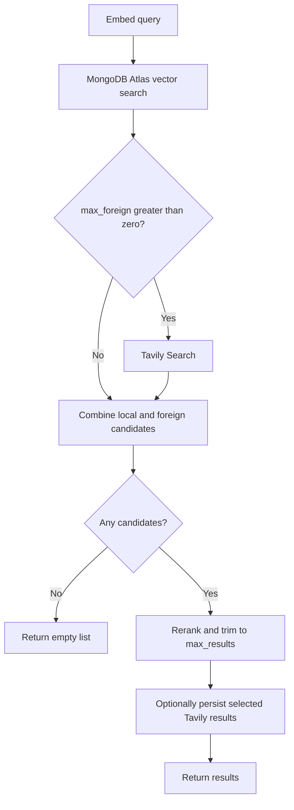

# MongoDB Provider for Tavily Hybrid RAG

The `MongoDB` adapter preserves the original MongoDB Atlas Hybrid RAG flow.
It validates the collection's vector index, retrieves local candidates, and
optionally inserts embedded Tavily results. The shared client owns embedding,
Tavily calls, and reranking.

See the [database adapter architecture](../architecture.md) for the common
contract and the legacy compatibility boundary.

## Setup and connection ownership

From this fork's repository checkout, install the SDK and the dependencies
needed for the example:

```bash
python -m pip install -e .
python -m pip install pymongo cohere
```

This branch does not define `mongodb`, `oracle`, or `hybrid` installation
extras. Cohere is needed only for the default embedding and ranking helpers;
custom callables can use another stack.

Set `TAVILY_API_KEY`, `CO_API_KEY`, `MONGO_URI`, `MONGO_DATABASE`,
`MONGO_COLLECTION`, and `MONGO_INDEX` in your environment before starting
Python. Your application creates the MongoDB client and supplies its collection:

```python
import os

from pymongo import MongoClient
from tavily import TavilyHybridClient
from tavily.databases.mongodb import MongoDB

mongo = MongoClient(os.environ["MONGO_URI"])
collection = mongo[os.environ["MONGO_DATABASE"]][os.environ["MONGO_COLLECTION"]]

client = TavilyHybridClient(
    api_key=os.environ["TAVILY_API_KEY"],
    database=MongoDB(
        collection=collection,
        index=os.environ["MONGO_INDEX"],
        embeddings_field="embeddings",
        content_field="content",
    ),
)

try:
    results = client.search(
        "Oracle vector search",
        max_results=5,
        max_local=5,
        max_foreign=5,
        save_foreign=True,
    )
finally:
    client.close()
    mongo.close()
```

`MongoDB` accepts `collection`, `index`, `embeddings_field`, and
`content_field`. It has no URI-based convenience constructor.
`client.close()` leaves the supplied MongoDB handle open; the application
closes `mongo`.

## Retrieval flow



The adapter returns `RetrievalDecision.merge_foreign(...)`. It has no
cache/memory routing option; Oracle's `retrieval_mode` and persistence
settings belong on `OracleDB`.

Use a positive `max_local`. The current aggregation sends its limit
directly to Atlas and uses `numCandidates=max_local + 3`; it does not short
circuit `max_local=0`. `max_foreign=0` disables the Tavily call while
retaining local retrieval and reranking.

## Collection and index requirements

Each searchable document needs a text field and a compatible embedding field,
named `content` and `embeddings` by default. The configured index must:

- exist on the collection;
- have `type="vectorSearch"`;
- contain the configured embedding field with `type="vector"`; and
- use cosine similarity.

Index validation runs during `TavilyHybridClient` initialization. The adapter
does not create the index. Local results are projected to `content`,
`score`, and `origin="local"`; arbitrary collection metadata is not
included in that projection.

## Persistence

With `save_foreign=True`, the shared client embeds Tavily result content
and the adapter creates documents with the configured content and embedding
field names. It then calls `collection.insert_many(...)`.

A callable `save_foreign` receives each original Tavily result plus an
`embeddings` field and returns the complete document to insert. Returning
`None` skips the document. Oracle-only metadata, semantic deduplication,
upsert, cleanup, and persistence caps do not apply to MongoDB.

## Legacy API

Existing MongoDB callers can keep the historical keyword form. This example
assumes the application supplies an open collection:

```python
legacy_client = TavilyHybridClient(
    api_key=os.environ["TAVILY_API_KEY"],
    db_provider="mongodb",
    collection=collection,
    index=os.environ["MONGO_INDEX"],
    embeddings_field="embeddings",
    content_field="content",
)
```

The historical positional form is also supported by
[`legacy_handling.py`](../legacy_handling.py). New applications should pass
a configured `database=MongoDB(...)`. Mixing that object with legacy database
keywords raises `TypeError`.

## Implementation

- [MongoDB adapter](mongodb.py): index validation, vector aggregation,
  document mapping, and insertion.
- [Shared client](../../hybrid_rag/hybrid_rag.py): default Cohere helpers,
  embedding, Tavily retrieval, merging/ranking, and persistence orchestration.
