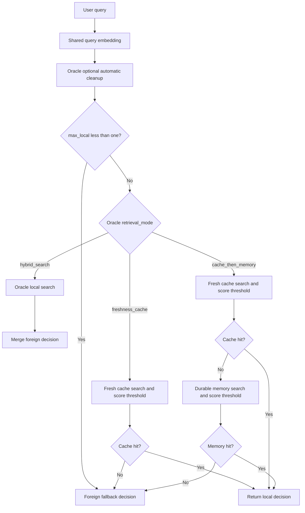
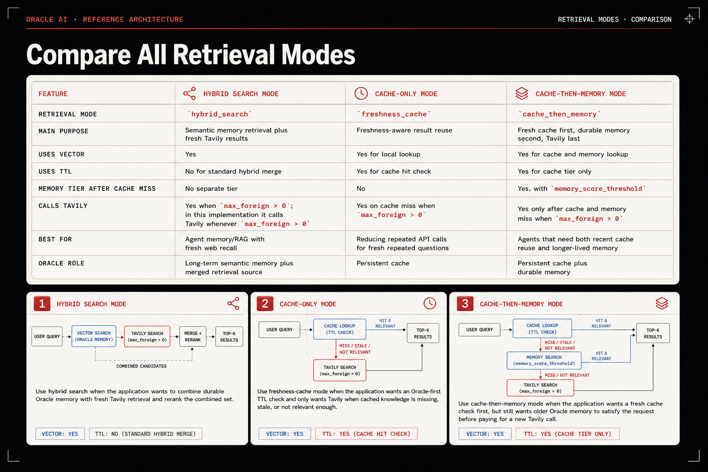
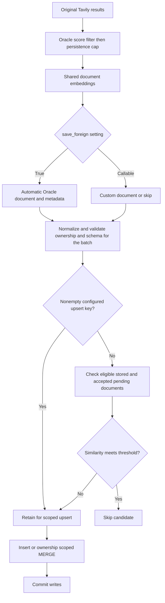

# Oracle Hybrid RAG Architecture

This document follows the implementation in [oracledb.py](oracledb.py).
Use the [integration guide](../../../examples/oracle/integration.md) for
setup and the [common contract](../architecture.md) for provider boundaries.

## Request routing

The shared client embeds the query before calling `OracleDB.retrieve()`.
The adapter can run automatic cleanup, then returns a
`RetrievalDecision`. Both cache and memory use the request's `max_local`
candidate limit and trim successful hits to `max_results`.

`vector_search_mode="exact"` is the default for every vector lookup, including
native-hybrid vector candidates and cache/memory tiers. Opt-in `"approx"` uses
explicit `FETCH APPROX` and an optional validated target accuracy, IVF probe count,
or HNSW EFSEARCH value. These query settings are separate from index creation
parameters. Semantic deduplication always uses `FETCH EXACT` because search
recall must not determine duplicate eligibility. See the
[query configuration](README.md#exact-and-approximate-vector-search) for options
and the migration from implicit `FETCH FIRST` behavior.

The shared client interprets those decisions as follows:

| Decision | Shared behavior |
| --- | --- |
| Return local | Return the supplied results immediately; skip Tavily, reranking, and persistence. |
| Merge foreign | Call Tavily if `max_foreign > 0`, project foreign results, combine them with local results, rerank nonempty candidates, and trim to `max_results`. |
| Foreign fallback | Call Tavily if enabled, project and trim its results, and skip reranking. |

After a merge or fallback, `save_foreign=True` or a callable can persist
selected Tavily results. Local hits are not rewritten. With
`max_foreign=0`, a fallback returns an empty list. Query embedding still
happens when `max_local=0`.

## Three retrieval modes

The illustration summarizes the normal positive-`max_local` paths. The
routing diagram above also covers the zero-local fallback.

### Hybrid search

`hybrid_search` searches the local table without cache freshness or memory
scope restrictions, while retaining configured `metadata_filters`.
It merges with Tavily whenever foreign retrieval is enabled, even if Oracle
has local matches. `max_foreign=0` gives a local-only merge/rerank pass.

### Freshness cache

`freshness_cache` applies a freshness predicate and then
`score >= cache_score_threshold`. Any retained hit returns immediately.
This mode does not add the cache/memory scope filter used by
`cache_then_memory`; configured metadata filters still apply.

Freshness is determined from the available columns:

| Table shape | Freshness predicate |
| --- | --- |
| `EXPIRES_AT` and cache timestamp | Future expiry, or a null expiry with a timestamp inside the TTL window. |
| `EXPIRES_AT` only | Future expiry. |
| Cache timestamp only | Timestamp inside the TTL window. |
| Neither | Raise a missing-cache-timestamp error. |

The default cache timestamp field is `ADDED_AT`.

### Cache then memory

`cache_then_memory` enables lifecycle metadata. Its cache tier restricts
`MEMORY_SCOPE` to `cache_only` or `cache_plus_memory`, applies freshness,
and keeps scores meeting `cache_score_threshold`.

On a cache miss, the memory tier searches `cache_plus_memory` rows without
a freshness predicate and applies `memory_score_threshold`. Memory hits
therefore survive cache expiry. There is no separate `memory_max_results`
option; this tier also uses `max_local`.

## Scores

Vector-only search orders by the configured `VECTOR_DISTANCE` and returns
`1 - distance`. `COSINE` is the default and is required for cache/memory
modes and semantic deduplication.

Native Oracle hybrid search is optional and disabled by default. When enabled,
it combines vector and text candidate sets by `ROWID`, retaining per-channel
maximum scores and adding `MAX(vector_score) + MAX(text_score)`. The text
component is `SCORE(1) / 100`. Cache/memory thresholds use that returned
combined score when native hybrid is enabled; deduplication uses cosine vector
similarity separately.

Text queries are reduced to alphanumeric tokens. Empty sanitized queries use
vector-only retrieval. Recognized Oracle Text query errors also trigger the
vector-only retry; unrelated exceptions propagate. Merged local and foreign
results are ordered by the configured shared reranker.

## Persistence pipeline

The deduplication branch is active only when
`dedup_similarity_threshold` is configured. A skipped custom document
never reaches normalization. No retained documents means no write.

Automatic document construction can add JSON payloads, detailed provenance,
lifecycle metadata, upsert keys, and the configured cache timestamp. A custom
`save_foreign` callback builds the complete document itself and receives
the original Tavily result plus its `embeddings`. Persistence filters apply
before either mapping path and do not change the search response.

### Ownership rules

`metadata_filters` applies to reads and cleanup and defines write scope:

- Scalar constraints fill missing document values and reject conflicts.
- A `None` constraint requires/stores null and uses `IS NULL` in SQL.
- List/tuple/set constraints require an explicit, non-null permitted value.
- Empty allowed sets reject writes. Conflicting case aliases of ownership
  columns are also rejected.

Upserts match the configured key plus the document's exact ownership values.
Scope columns are excluded from updates. A document missing the configured
key uses the insert path.

Deduplication uses the candidate's exact scope rather than the client's whole
allowed-value list. It considers both eligible stored rows and documents
accepted earlier in the current batch. Available origin-marker columns must
each contain `"tavily"`. If lifecycle columns are available, expired
`cache_only` references are excluded; durable-memory references remain
eligible.

Automatic documents receive available origin markers whenever deduplication
is enabled, independently of `enable_provenance_metadata`. Custom/direct
documents are not relabeled, and stored unmarked rows are not migrated.
If neither origin column exists, only the remaining scope/lifecycle rules
restrict candidate references.

Keyed documents bypass semantic suppression to preserve updates. They can
still be references for later unkeyed candidates if eligible. Pending-document
comparisons use Oracle similarity and predicates, so large batches can incur
pairwise database reads. Concurrent calls do not get a database uniqueness
guarantee from this check.

### Transactions and lifecycle metadata

The batch is normalized and its schema validated before semantic filtering
can discard documents. Plain inserts use `executemany`; keyed documents
use `MERGE`, and unkeyed documents can be inserted in the same write
transaction. Insert/MERGE execution failures roll back pending writes.

`QUERY_COUNT` starts at one for automatically built lifecycle documents
and increments on keyed updates. `LAST_SEEN_AT` is also a write/upsert
timestamp. Local hits do not refresh these fields.

## Cleanup rules

Cleanup applies ownership filters to the entire deletion predicate, including
legacy alternatives, and preserves `cache_plus_memory` rows.

| Available columns | Eligible expired rows |
| --- | --- |
| `MEMORY_SCOPE` and `EXPIRES_AT` | `cache_only` rows with a past expiry; null expiry can use an old cache timestamp if available. Null-scope legacy rows also require cache-mode provenance. |
| `MEMORY_SCOPE` and cache timestamp, without expiry | Old `cache_only` rows. |
| Cache timestamp without `MEMORY_SCOPE` | Old rows with cache-mode provenance. |
| Insufficient lifecycle/timestamp columns | No deletion; return zero. |

Here, cache-mode provenance means `RETRIEVAL_MODE` is
`freshness_cache` or `cache_then_memory`, with every available
`PROVIDER_NAME`/`INSERTED_FROM` marker equal to `"tavily"`.
A legacy row without enough evidence is preserved.

A lifecycle schema containing `MEMORY_SCOPE` and `EXPIRES_AT` can
be cleaned without `ADDED_AT`; the unused timestamp bind is omitted.
Automatic cache persistence still writes the configured cache timestamp,
so its schema requirements are separate from read-only cleanup support.

`cleanup_cache()` commits and returns its deleted row count.
`auto_cleanup_cache=True` runs cleanup before retrieval, including a
zero-local fallback, and rate-limits successful runs with a monotonic clock.

## Connection and initialization lifecycle

The shared client resolves legacy/new constructor arguments before accepting
the backend. Callable validation, backend validation, and Tavily client
creation then share a cleanup handler. An invalid embedding or ranking
callable closes a managed Oracle connection; an injected connection remains
open. Normal `client.close()` uses the same ownership rule.

The adapter commits writes, cleanup, and index creation even with an injected
connection. The application remains responsible for connection allocation and
for keeping unrelated pending work out of those transactions.

## Implementation map

| Concern | Source/tests |
| --- | --- |
| Shared orchestration and callable cleanup | [hybrid_rag.py](../../hybrid_rag/hybrid_rag.py), [safety tests](../../../tests/test_hybrid_rag_safety.py) |
| Protocol and retrieval decisions | [base.py](../base.py), [contract tests](../../../tests/test_database_contract.py) |
| Legacy MongoDB constructor support | [legacy_handling.py](../legacy_handling.py), [compatibility tests](../../../tests/test_api_compatibility.py) |
| Oracle routing, SQL, and helpers | [oracledb.py](oracledb.py), [Oracle tests](../../../tests/test_hybrid_rag_oracle.py) |
| Scoped cleanup and writes | [ownership tests](../../../tests/test_oracle_persistence_scope.py) |
| Origin markers and scoped/batch deduplication | [deduplication tests](../../../tests/test_oracle_dedup_provenance.py) |
